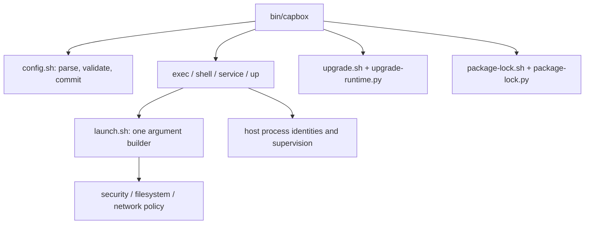

# Runtime architecture

The CLI resolves a workspace, loads a complete runtime bundle and dispatches a command. Required modules are checked explicitly; a partially copied installation fails before running guest code.

- `lib/version.sh`: the public CLI and schema versions.
- `lib/config.sh`: whitelist parsing, validation, serialized batch persistence and effective defaults. The caller chooses when to load configuration.
- `lib/launch.sh`: the shared bwrap parameter builder used by exec, shell, services and daemon. It builds arguments without starting the process. Daemon's historical fallback entry delegates here and refuses missing policy modules.
- `lib/common.sh`: runtime paths, protected filesystem utilities, locking, shared execution wrappers, status and diagnostics. Further extraction can follow separately; the public shell function interfaces remain stable.
- `lib/service.sh` and `lib/service-supervisor.py`: service definitions, readiness, process lifetime and restart policy.
- `lib/upgrade.sh`: stop-state checks and the project upgrade lock. `upgrade-runtime.py` stages/validates complete runtime trees, records private recovery state and restores backups after failure.
- `lib/package-lock.sh`: runs the normal guest package wrapper. `package-lock.py` validates data, produces exact package arguments and compares the installed set.

Host launchers, process identity records, BPF and helpers remain outside the guest-visible workspace. Upgrade backups use persistent host state storage, separate from disposable runtime files. Project config and rootfs are data and are never interpreted as host shell programs.
