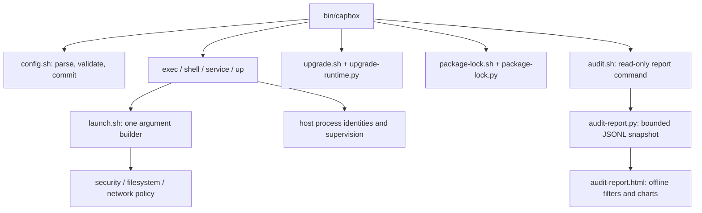

# 运行时架构

CLI 解析工作区、加载完整运行时包并分发命令。必选模块会显式检查；安装不完整时在跑 guest 代码前失败。

- `lib/version.sh`：对外 CLI 与 schema 版本。
- `lib/config.sh`：白名单解析、校验、序列化批量落盘与有效默认值。由调用方决定何时加载配置。
- `lib/launch.sh`：exec / shell / service / daemon 共用的 bwrap 参数构建器，只组参不启动进程。daemon 的历史兜底入口也走这里，缺策略模块则拒绝。
- `lib/common.sh`：运行时路径、受保护文件系统工具、锁、共享执行封装、状态与诊断。后续可再拆分；对外 shell 函数接口保持稳定。
- `lib/service.sh` 与 `lib/service-supervisor.py`：服务定义、就绪、进程寿命与重启策略。
- `lib/upgrade.sh`：停机检查与项目升级锁。`upgrade-runtime.py` 暂存/校验完整运行时树，记录私有恢复状态，失败后回滚备份。
- `lib/package-lock.sh`：调用常规 guest 包封装。`package-lock.py` 校验数据、生成精确包参数并比对已装集合。
- `lib/audit-report.py` 及其 HTML 模板：对选定的审计 JSONL 快照做有界规范化，再在工作区外发布私有、自包含报告。浏览器交互只用嵌入数据；不暴露启动器或控制服务。
- `lib/oci-image.py`：不连接 Docker daemon。读取 docker-archive、OCI layout 或 OCI archive，按层展开 whiteout，把 rootfs 写到 `.capbox/images/docker/<name>/`。镜像配置是数据；启动仍只走 `launch.sh`。

宿主启动器、进程身份记录、BPF 与辅助程序留在 guest 可见工作区之外。升级备份用持久宿主状态存储，与一次性运行时文件分开。项目配置与 rootfs 是数据，绝不当作宿主 shell 程序解释。Docker/OCI 镜像同样只当数据展开，不在宿主执行其中的 Entrypoint、Cmd 或 Env。
